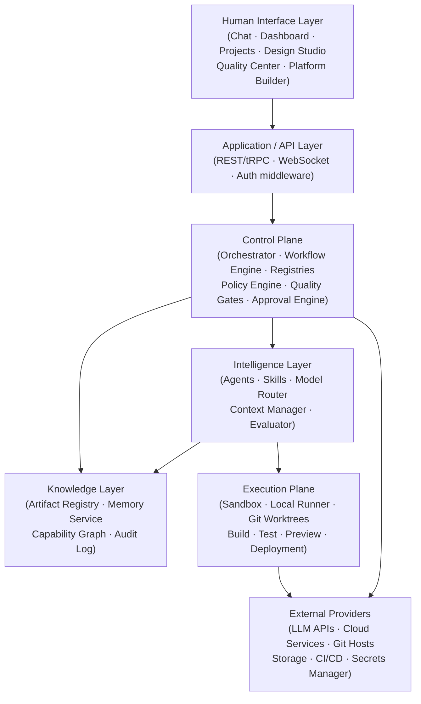

# ForgeOS — Target Architecture

**Date:** 2026-10-24
**Based on:** `requirements/03_System_Architecture.md`, ADR-001–ADR-009

---

## Architecture Decision Records (Confirmed)

| ADR | Decision |
|-----|----------|
| ADR-001 | Outcome-first — features ship when evidence of value, not just code |
| ADR-002 | Adaptive workforce — right agents for each task, not all agents every time |
| ADR-003 | Modular monolith first — split into services only when measured need justifies it |
| ADR-004 | Artifact-driven traceability — every output is versioned with provenance |
| ADR-005 | Persistent orchestration — workflow survives restarts |
| ADR-006 | Controlled platform evolution via PlatformChangeSet |
| ADR-007 | Adaptive UI — one workspace that adapts, not one page per agent |
| ADR-008 | Security/permission/approval/audit by design — not an afterthought |
| ADR-009 | Evidence-based completion — no false success claims |

---

## System Layers



---

## Technology Stack (Selected)

| Layer | Technology | Rationale |
|-------|-----------|-----------|
| Frontend | **Next.js 14+ / React / TypeScript** | App Router, SSR, excellent DX, TypeScript-first |
| Backend | **NestJS / TypeScript** | Module system maps well to ForgeOS modules, DI, decorators |
| Database | **PostgreSQL** | Relational, JSONB for flexibility, full-text search, proven |
| Object storage | **MinIO** (local) / S3-compatible | Artifact storage, exportable, local-first |
| Workflow engine | **Custom durable queue on PostgreSQL** | Simple start; Temporal if complexity warrants |
| Auth | **JWT + RBAC** (via Passport.js / NestJS guards) | Standard, extensible |
| Model adapters | **Vercel AI SDK** + custom adapters | Multi-provider, streaming, tool calls |
| Package manager | **pnpm workspaces** | Monorepo, efficient, fast |
| ORM | **Prisma** | TypeScript-native, migrations, type-safe queries |
| API contracts | **tRPC** (internal) + **OpenAPI** (external) | Type safety + discoverability |
| Testing | **Vitest** (unit/integration) + **Playwright** (e2e) | Fast, TypeScript-native |
| Observability | **OpenTelemetry** + **Pino** (structured logs) | Standard, vendor-neutral |

---

## Monorepo Structure (Target)

```
ForgeOS/
├── apps/
│   └── web/                    # Next.js frontend
│       ├── app/                # App Router pages
│       ├── components/         # UI components
│       └── lib/                # Frontend utilities
├── platform/
│   ├── orchestrator/           # Core orchestration logic
│   ├── workflow-engine/        # Durable workflow state machine
│   ├── agent-registry/         # Role/skill/tool/model registry
│   ├── artifact-registry/      # Artifact storage + versioning
│   ├── persistent-memory/      # Memory service
│   ├── policy-engine/          # Authorization + approval gates
│   ├── quality-engine/         # Quality gates + evaluation
│   ├── model-gateway/          # LLM adapter layer
│   ├── observability/          # Logging, metrics, traces
│   └── platform-builder/       # Controlled system evolution
├── packages/
│   ├── types/                  # Shared TypeScript types + Prisma schema
│   ├── ui/                     # Shared React components (design system)
│   ├── api-contracts/          # tRPC router + OpenAPI specs
│   └── config/                 # Shared ESLint/TS/Vitest configs
├── agents/
│   └── roles/                  # Agent role definitions (JSON/YAML)
├── infrastructure/
│   ├── database/               # Prisma schema, migrations, seeds
│   ├── containers/             # Dockerfile, docker-compose
│   ├── local-runner/           # Sandbox execution adapter
│   └── monitoring/             # OpenTelemetry collector config
├── tests/
│   ├── unit/                   # Unit tests (co-located preferred)
│   ├── integration/            # API + DB integration tests
│   ├── e2e/                    # Playwright end-to-end tests
│   ├── security/               # Security and injection tests
│   └── agent-evaluations/      # Agent outcome evaluation tests
├── scripts/                    # Dev setup, migration, maintenance
├── docs/
│   └── implementation/         # Audit, plans, architecture docs
└── runtime-data/               # Git-ignored runtime artifacts
```

---

## Core Data Model (Logical)

### Primary Entities

```
Project ─── Conversation ─── Message
    │               └────────── Intent
    │
    ├── Requirement
    ├── Decision
    ├── WorkflowDefinition ─── WorkflowRun ─── Task ─── AgentRun
    ├── Artifact ─── ArtifactVersion
    ├── ApprovalRecord
    └── QualityGateResult

AgentRegistry ─── Role ─── Skill ─── Tool
ModelGateway  ─── ModelProvider ─── ModelConfig
PolicyEngine  ─── Policy ─── Permission
AuditLog      ─── AuditEvent

MemoryItem ─── MemoryVersion
           ─── MemorySource
           ─── MemoryRelation
           ─── MemoryFeedback

PlatformChangeSet ─── CapabilityNode ─── CapabilityEdge
```

### Domain Events (versioned)

`ProjectCreated`, `PlanProposed`, `PlanApproved`, `TaskStarted`, `TaskCompleted`, `TaskFailed`,
`ArtifactCreated`, `ArtifactVersioned`, `ApprovalRequested`, `ApprovalGranted`, `ApprovalDenied`,
`QualityGatePassed`, `QualityGateFailed`, `WorkflowResumed`, `WorkflowCheckpointed`,
`MemoryCaptured`, `MemoryRetrieved`, `PlatformChangeReleased`, `DeploymentVerified`

---

## Security Boundaries

- **Least privilege:** every agent run is scoped to goal/context/permissions/budget
- **Default deny:** cross-project memory, resource access denied unless explicitly granted
- **Approval gates:** required for production deployment, privilege changes, destructive ops, platform changes
- **Secret management:** never in source, memory, logs, or embeddings — use runtime secret store
- **Execution sandbox:** network/filesystem/env/time limits enforced per run
- **Audit:** every sensitive action logged with actor, target, decision, timestamp

---

## Performance Targets (NFR-derived)

| Metric | Target |
|--------|--------|
| Lightweight API (p95) | < 500 ms |
| Main page load (p95) | < 3 s |
| Workflow checkpoint write | < 100 ms |
| Memory retrieval | < 500 ms |
| Status updates | Real-time (WebSocket / SSE) |
| AI operations | Streaming with timeout + telemetry |
